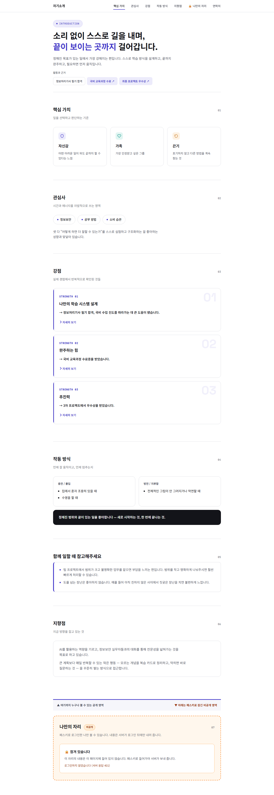
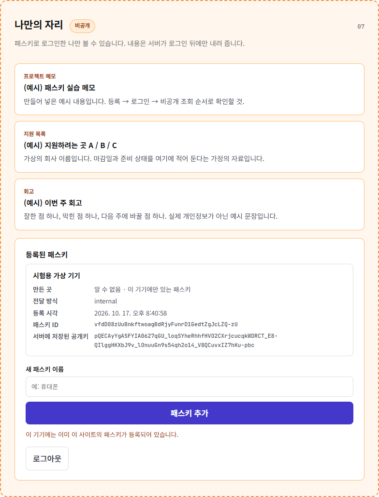

# 과제 8 — 내 소개 페이지에 패스키 달기

1번에서 만든 소개 페이지(공개)는 그대로 두고, 맨 아래에 **패스키로 잠그는 비공개 자리**를 붙이는 과제입니다.
비밀번호는 만들지 않습니다. 비공개 자리에 들어 있는 내용은 모두 **만들어 넣은 예시**이며 실제 개인정보는 없습니다.

- 공개 결과물 주소: (배포 후 기입)
- 소스 주소: (저장소 생성 후 기입)

## 진행 상황

| 카드 | 내용 | 상태 |
|---|---|---|
| 1 | 무엇을 잠글지 가르기 (공개/비공개 분리) | 구현 + 로컬 검증 완료 |
| 2 | 패스키 등록 | 구현 + 가상 기기로 검증 완료 · **실제 기기 등록 증거는 아직** (C26) |
| 3~5 | 로그인 · 두 번째 패스키 · 남의 패스키 거절 | 대기 |

## 소스에서 찾는 위치

| 하는 일 | 파일 |
|---|---|
| 공개 영역 (누구나 받는 파일) | `public/index.html`, `public/app.js`, `public/evidence/` |
| 비공개 자료 조회 (`GET /api/vault`) | `server/index.js` |
| 로그인 여부 검사 (없으면 401) | `server/session.js` 의 `requireLogin` |
| 비공개 자료 원본 (서버에만 있음) | `data/vault.json` |
| 등록용 질문 만들기 (`POST /api/register/options`) | `server/passkeys.js` |
| 등록 확인·공개키 저장 (`POST /api/register/verify`) | `server/passkeys.js` → `server/store.js` |
| 등록 취소 · 패스키 목록 · 로그아웃 | `server/passkeys.js` |
| 화면의 등록 폼·취소 안내·목록 | `public/app.js` |
| 로그인(패스키로 들어가기) | 카드 3에서 추가 |

## 카드 1 — 무엇을 잠글지 먼저 가른다

### 설계
- `public/` 안의 파일만 웹으로 나갑니다. 비공개 내용(`data/vault.json`)은 이 폴더 **밖**에 있어서 파일 주소로는 받을 수 없습니다.
- 화면의 비공개 자리는 처음부터 비어 있고, 로드될 때 `/api/vault` 를 요청합니다. 서버가 로그인 확인 뒤에만 내용을 내려 줍니다. 화면에서 숨기는 방식이 아니라 **애초에 보내지 않는 방식**입니다.
- 비공개 영역에는 항목 3개가 있습니다: 프로젝트 메모 / 지원 목록 / 회고 (모두 예시).

### 통과 기준 확인 결과 (로컬, 2026-10-17)

| 번호 | 기준 | 결과 | 확인 방법 |
|---|---|---|---|
| C13 | 공개/비공개가 화면에서 구분됨 | 통과 | 파란 경계선 + 주황 점선 영역 ([화면](evidence/card1-public-private-boundary.png)) |
| C14 | 비공개 항목 3개 이상 | 통과 | `data/vault.json` 3개 |
| C15 | 로그인 전에는 내용이 화면에 안 보임 | 통과 | 화면에 "잠겨 있습니다" 만 표시 |
| C16 | 로그인 없이 직접 요청하면 거절 | 통과 | 아래 응답 |
| C17 | 거절이 401 또는 403 | 통과 | `401 Unauthorized` |
| C18 | 로그인 없이 받은 페이지 소스에 비공개 내용 없음 | 통과 | 6개 문장 모두 포함 여부 False |

덧붙여, `/data/vault.json`, `/server/index.js`, `/package.json` 을 직접 요청해도 모두 404 입니다.

### 남길 것

**1) 공개 영역과 비공개 영역을 가른 화면**



맨 아래 파란 선 위가 공개, 주황 점선 상자가 비공개입니다. 로그인 전이라 "잠겨 있습니다 (서버 응답 401)" 만 보입니다.

**2) 로그인 없이 받은 응답 본문**

```
$ curl.exe -i http://localhost:3000/api/vault
HTTP/1.1 401 Unauthorized
Content-Type: application/json; charset=utf-8

{"error":"unauthorized"}
```

로그인 없이 받은 페이지 소스(20792글자)에서 비공개 항목의 제목·본문을 검색한 결과는 전부 `False` 입니다.
전체 기록: [evidence/card1-no-login-response.txt](evidence/card1-no-login-response.txt)

### 막혔을 때 확인 순서
1. 화면엔 안 보이는데 페이지 소스에 있나? → 숨김(CSS/hidden)만 쓴 게 아닌지 확인
2. 비공개 내용을 서버가 로그인 뒤에만 내려 주나? → `server/index.js` 의 `requireLogin` 확인
3. 로그인 없이 받은 응답 본문을 직접 열어 확인 → `evidence/card1-no-login-response.txt` 와 같은 결과여야 함

## 카드 2 — 패스키를 등록한다

### 흐름
1. 브라우저가 서버에 등록을 요청하면, 서버가 **일회용 질문(challenge)** 을 만들어 보내고 확인할 때까지 서버 메모리에 보관합니다 (5분 안에 한 번만 사용 가능).
2. 기기가 열쇠 한 쌍을 만듭니다. 개인키는 기기 안에 남고, **공개키와 질문에 대한 서명**만 서버로 돌아옵니다.
3. 서버가 서명과 질문을 확인하고, 맞으면 공개키를 저장하며 사람이 알아볼 이름(예: "내 노트북")을 함께 저장합니다.
4. 질문은 꺼내 쓰는 즉시 지워지므로 같은 요청을 다시 보내면 거절됩니다.

**처음 한 번만 필요한 초대 코드.** 공개 사이트에서 아무나 먼저 패스키를 등록해 주인 행세를 하면 안 되므로, 패스키가 하나도 없을 때의 첫 등록에는 서버 주인이 환경변수 `SETUP_CODE` 로 정한 초대 코드가 필요합니다. 로그인 비밀번호가 아니고, 패스키가 하나라도 생기면 쓰이지 않습니다. 그 뒤의 패스키 추가는 로그인한 사람만 할 수 있습니다. 코드 값은 저장소에 없습니다.

### 통과 기준 확인 결과

가상 인증기(브라우저 개발자 도구가 제공하는 가짜 기기)로 `node tools/check-card2.mjs` 를 돌린 결과입니다. 전체 기록: [evidence/card2-check-result.txt](evidence/card2-check-result.txt)

| 번호 | 기준 | 결과 | 근거 |
|---|---|---|---|
| C19 | 질문을 만들어 보내고 확인할 때까지 보관 | 통과 | `server/passkeys.js` 의 `pendingChallenges` |
| C20 | 요청마다 질문이 다름 | 통과 | 아래 두 값 |
| C21 | 등록이 끝나면 공개키 저장 | 통과 | 아래 저장된 값 |
| C22 | 저장된 값 + 공개키라는 설명 | 통과 | 아래 |
| C23 | 개인키가 서버로 가지 않음 | 통과 | 아래 요청 본문 |
| C24 | 사람이 알아볼 이름 | 통과 | 저장된 값의 `name`, 목록 화면 |
| C25 | 취소하면 안내 + 저장 없음 | 통과 | 아래 |
| C26 | 저장 위치가 어디인지 | 통과 (localhost, 실제 기기) | 아래 "실제 기기로 등록한 결과" |

**C20 — 요청마다 다른 질문** (같은 화면에서 두 번 연속 요청)
```
요청 1 challenge: a6YUVrNsnaW64Ty1tf9X5fDuNretdaTIfKk-gklm6fM
요청 2 challenge: b5OkPgKZMAMV75WqL4B0gbVHZtc9CQidfHShqIiPt80
```

**C21·C22 — 서버에 저장된 값** ([evidence/card2-server-store.json](evidence/card2-server-store.json))
```json
{
  "id": "vfdD08zUuBnkftwoagBdRjyFunrD1GedtZgJcLZQ-zU",
  "publicKey": "pQECAyYgASFYIA0627qGU_loqSYheRhhfHVO2CXrjcucqkWDRCT_E8-QIlggHKXbJ9v_lOnuuGn9s54qh2o14_V8QCuvxIZ7hKu-pbc",
  "counter": 1,
  "transports": ["internal"],
  "name": "시험용 가상 기기"
}
```
- `publicKey` 는 **공개키**입니다 (ES256 곡선 위의 점 좌표 두 개를 담은 값). 이것만으로는 로그인할 수 없고, 서명이 맞는지 **확인**하는 데만 쓰입니다. 유출돼도 남이 내 이름으로 서명할 수 없다는 점에서 비밀번호와 다릅니다.
- 비밀번호나 개인키에 해당하는 필드는 저장소에 없습니다. `id` 는 이 패스키를 가리키는 이름표입니다.
- 요청 본문의 `publicKey`(SPKI 형식)와 저장된 `publicKey`(COSE 형식)는 같은 공개키를 다르게 적은 것입니다.

**C23 — 서버로 간 등록 요청 본문** (`POST /api/register/verify`, 긴 값은 줄임, 전체: [evidence/card2-server-events.jsonl](evidence/card2-server-events.jsonl) 의 `register-request-body`)
```json
{
  "id": "vfdD08zUuBnkftwoagBdRjyFunrD1GedtZgJcLZQ-zU",
  "rawId": "vfdD08zUuBnkftwoagBdRjyFunrD1GedtZgJcLZQ-zU",
  "response": {
    "attestationObject": "o2NmbXRkbm9uZWdhdHRTdG10oGhhdXRoRGF0YVik…(생략)",
    "clientDataJSON": "eyJ0eXBlIjoid2ViYXV0aG4uY3JlYXRlIiwiY2hhbGxlbmdl…(생략)",
    "transports": ["internal"],
    "publicKeyAlgorithm": -7,
    "publicKey": "MFkwEwYHKoZIzj0CAQYIKoZIzj0DAQcDQgAEDTrbuoZT-WipJiF5GGF8dU7YJeuNy5yqRYNEJP8Tz5Acpdsn2_-U6e64af2zniqHajXj9XxAK6_EhnuEq76ltw",
    "authenticatorData": "SZYN5YgOjGh0NBcPZHZgW4_krrmihjLHmVzzuoMdl2NF…(생략)"
  },
  "type": "public-key",
  "authenticatorAttachment": "platform"
}
```
- 본문의 키는 `id, rawId, response, type, clientExtensionResults, authenticatorAttachment` 와 `response` 안의 `attestationObject, clientDataJSON, transports, publicKeyAlgorithm, publicKey, authenticatorData` 뿐입니다. **개인키가 들어갈 자리가 없습니다.**
- `clientDataJSON` 을 풀면 `{"type":"webauthn.create","challenge":"UvoXzG2H…","origin":"http://localhost:3100"}` 로, 서버가 낸 질문과 접속한 주소가 서명 대상에 들어 있습니다.
- 가상 기기 안에는 개인키가 1개 있었고(`WebAuthn.getCredentials`), 서버 저장 파일에는 그 값이 없었습니다.
- 같은 요청을 다시 보내면 `400 challenge-expired-or-used` 로 거절됩니다 (질문은 한 번 쓰면 폐기).

**C25 — 등록 취소**: 패스키 창에서 취소(`NotAllowedError`)하면 화면에 "등록을 취소했습니다. 아무것도 저장되지 않았습니다." 가 나오고, 서버는 보관하던 질문만 버립니다 (`register-cancelled`). 취소 뒤 `GET /api/status` 는 `{"registered":false}` 이고 저장 파일이 만들어지지 않았습니다. (이번 확인은 취소를 코드로 흉내 낸 것이라, 실제 기기 창에서 취소해 보는 확인이 남아 있습니다.)

**패스키 목록 화면**



### 실제 기기로 등록한 결과 (2026-10-17, `http://localhost:3000`)

위의 가상 기기와 별도로, 내 PC에서 실제로 등록했습니다. ([evidence/card2-real-device-store.json](evidence/card2-real-device-store.json), [evidence/card2-real-device-events.jsonl](evidence/card2-real-device-events.jsonl))

```json
{
  "id": "wzVzCh6o2rzAyLtT72UsbURg4LovhW7ggwJC6JGKmO4",
  "publicKey": "pQECAyYgASFYIBd3shO3as5Q9VxcBxXF2FvkZphZNtI0Xb54pmgikMjcIlggulhOuYjG2ZxXEK6f_-shMGWWNZoWl_f1WUO7a4ztsA4",
  "transports": ["internal"],
  "deviceType": "singleDevice",
  "backedUp": false,
  "aaguid": "08987058-cadc-4b81-b6e1-30de50dcbe96",
  "name": "집 PC 데스크탑"
}
```

- **C26 저장 위치: 기기 자체 — Windows Hello.** `aaguid` `08987058-cadc-4b81-b6e1-30de50dcbe96` 은 Windows Hello 의 인증기 식별값이고, `transports: ["internal"]`(기기 내부), `authenticatorAttachment: "platform"`(기기에 붙은 인증기), `deviceType: "singleDevice"` + `backedUp: false`(다른 기기로 동기화되지 않음)가 모두 같은 결론입니다. 구글 비밀번호 관리자나 보안 키가 아닙니다.
- **C23 (실제 요청)**: 서버가 받은 본문의 키는 `id, rawId, response, type, clientExtensionResults, authenticatorAttachment` 와 `response` 안의 `attestationObject, clientDataJSON, transports, publicKeyAlgorithm, publicKey, authenticatorData` 뿐이고, 본문 전체에 `private` 이라는 글자가 없습니다.
- `clientDataJSON` 풀이: `{"type":"webauthn.create","challenge":"QrAwRrbI…","origin":"http://localhost:3000"}` — 서버가 낸 질문(`challenge-issued` 기록의 값)과 같습니다.
- 한계: Windows Hello 는 서버가 받은 정보만으로 "패스키가 어디 저장됐다"고 직접 알려 주지 않고, 위 값들(`aaguid` 등)로 **추론**한 것입니다.

### 아직 남은 것
- 실제 기기 창에서 **취소**해 보기 (앱 안 브라우저로 시도했을 때 서버에 `register-cancelled` 가 한 번 기록됐지만, 사람이 직접 취소한 것인지 확인하지 못해 증거로 쓰지 않습니다).
- 패스키는 접속 주소(RP ID)에 묶이므로, `localhost` 에서 만든 패스키는 배포 주소에서 쓸 수 없습니다. 제출용 증거는 배포 주소에서 다시 등록해 남깁니다.
- 브라우저에 보이는 목록 화면의 실제 캡처 (지금 있는 `card2-passkey-list.png` 는 가상 기기 화면).

### 막혔을 때 확인 순서
1. 패스키 창이 안 뜸 → 주소가 https 인지 (개발 중에는 `localhost` 만 예외)
2. 브라우저·기기가 패스키를 지원하는지
3. "이 기기에는 이미 이 사이트의 패스키가 등록되어 있습니다" → 이미 등록된 패스키가 있는 것 (목록 화면에서 확인)

## 실행

```bash
npm install
npm start   # http://localhost:3000 — 처음 실행하면 콘솔에 일회용 초대 코드가 나옵니다
```

배포할 때는 환경변수 `ORIGIN`(예: `https://내도메인`), `SETUP_CODE`(초대 코드), `NODE_ENV=production` 을 정합니다. 가상 기기 확인: `node tools/check-card2.mjs` (Edge 필요).
